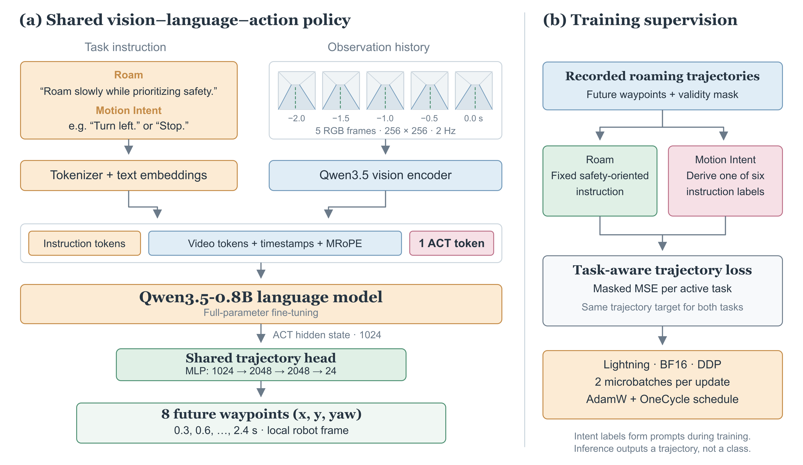
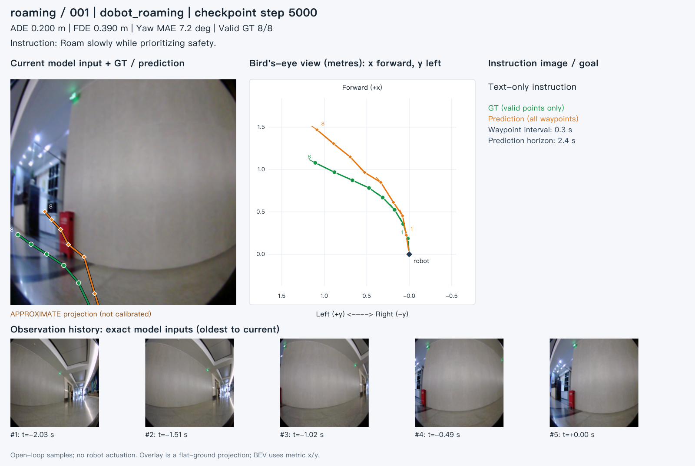
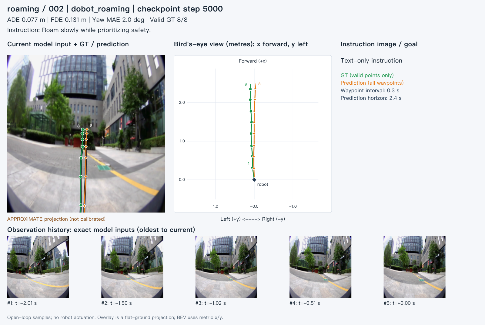
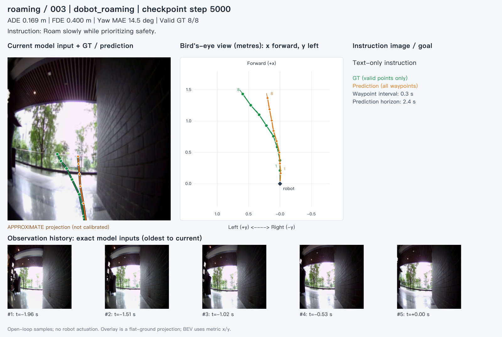
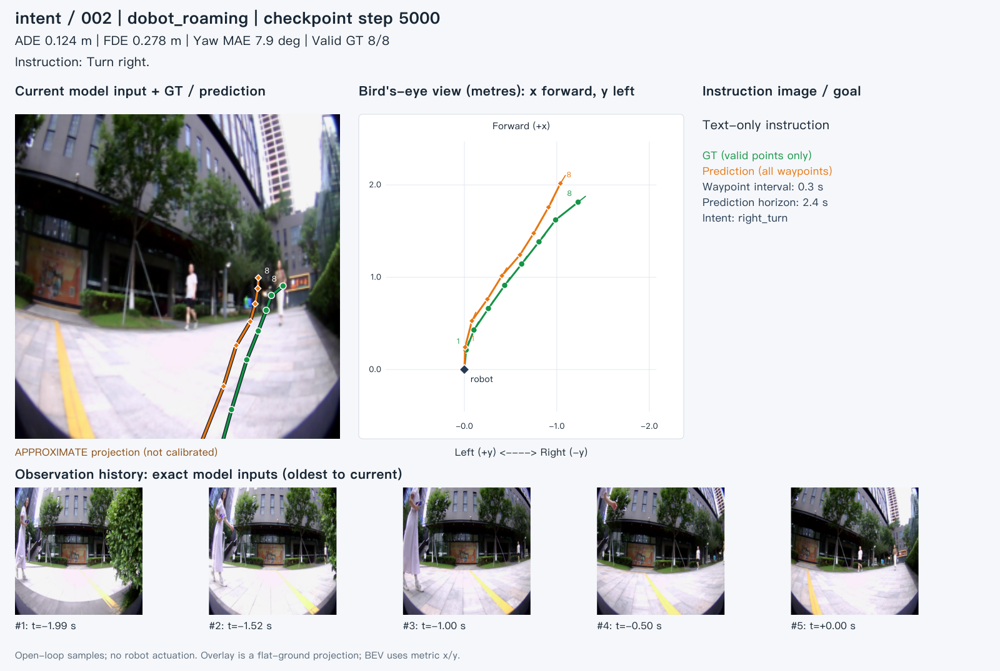
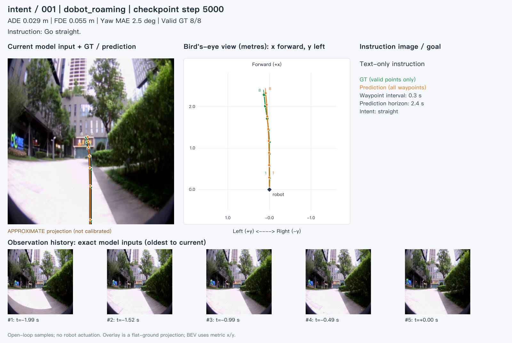
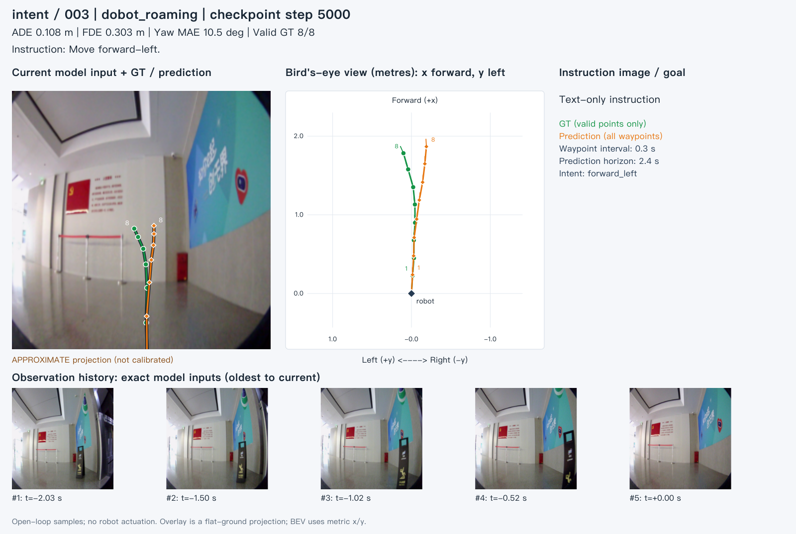
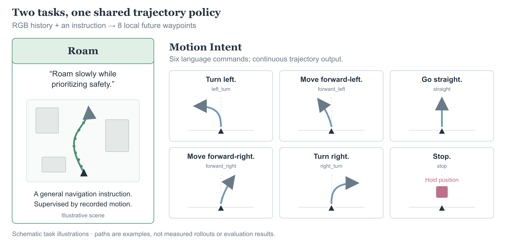

<div align="center">

# DobotRoam

### Roaming and Motion-Intent Navigation with a Shared Vision-Language-Action Policy

Chengrui Wei<sup>1</sup>, Songyuan Liu<sup>1</sup><br>, Liu Liang<sup>1</sup>, Pengkun Zheng<sup>1,†</sup>

<sup>1</sup>Dobot Robotics &nbsp; <sup>†</sup>Project lead
<!-- <sup>&#42;</sup>Corresponding authors &nbsp; <sup>†</sup>Project lead -->

**Qwen3.5-0.8B · One ACT Token · Two Navigation Tasks · PyTorch Lightning**

[Overview](#overview) · [Tasks](#navigation-tasks) · [Examples](#qualitative-results) · [Model](#model)

</div>

## Overview

**DobotRoam** learns **Roam** and **Motion Intent** with one shared vision-language-action policy. Given a short history of RGB observations and a natural-language instruction, **Qwen3.5-0.8B** produces a single **ACT hidden state**. A shared trajectory head maps this state to **8 future egocentric waypoints**, each containing **x, y and yaw**.



*Shared model and training supervision. Motion-intent labels are derived from ground-truth trajectories to construct instructions during training; inference consumes an instruction and predicts a trajectory.*

## News

- **[2026-11-05]** Roam + Motion Intent documentation, architecture figures and a dedicated two-task training configuration are available. Six open-loop evaluation visualizations are included below.
- **[2026-11-04]** The original Qwen3.5 Omni model and optimization method were integrated with PyTorch Lightning.

## Qualitative results

**Green: ground truth. Orange: prediction.** Each visualization contains the current RGB input, a metric bird's-eye trajectory plot, and the five observation frames. Waypoints are spaced by **0.3 s**, spanning **2.4 s**. The camera overlay uses an **approximate, uncalibrated flat-ground projection**; the bird's-eye view uses local metric coordinates. No robot actuation is shown.

### Roam

**Instruction:** “Roam slowly while prioritizing safety.”

<a href="assets/omni/eval_20261014/roaming_001.svg"></a>

*Roam / 001 — indoor corridor. Click the image to open the original SVG.*

<details>
<summary><strong>View two more Roam examples</strong></summary>

**Roam / 002 — outdoor walkway.**

<a href="assets/omni/eval_20261014/roaming_002.svg"></a>

**Roam / 003 — covered passage.**

<a href="assets/omni/eval_20261014/roaming_003.svg"></a>

</details>

### Motion Intent

**Instruction:** “Turn right.”

<a href="assets/omni/eval_20261014/intent_002.svg"></a>

*Motion Intent / 002 — right-turn instruction. Click the image to open the original SVG.*

<details>
<summary><strong>View “Go straight.” and “Move forward-left.” examples</strong></summary>

**Motion Intent / 001 — “Go straight.”**

<a href="assets/omni/eval_20261014/intent_001.svg"></a>

**Motion Intent / 003 — “Move forward-left.”**

<a href="assets/omni/eval_20261014/intent_003.svg"></a>

</details>

### Displayed-sample metrics

These values are copied from the six saved sample records. **They are per-example metrics, not an aggregate benchmark result.** All six examples have 8 valid ground-truth waypoints. ADE and FDE measure XY displacement; yaw MAE is reported separately.

| Sample | Instruction | ADE ↓ (m) | FDE ↓ (m) | Yaw MAE ↓ (°) |
|---|---|---:|---:|---:|
| [Roam / 001](assets/omni/eval_20261014/roaming_001.svg) | Roam slowly while prioritizing safety. | 0.200 | 0.390 | 7.2 |
| [Roam / 002](assets/omni/eval_20261014/roaming_002.svg) | Roam slowly while prioritizing safety. | 0.077 | 0.131 | 2.0 |
| [Roam / 003](assets/omni/eval_20261014/roaming_003.svg) | Roam slowly while prioritizing safety. | 0.169 | 0.400 | 14.5 |
| [Motion Intent / 001](assets/omni/eval_20261014/intent_001.svg) | Go straight. | 0.029 | 0.055 | 2.5 |
| [Motion Intent / 002](assets/omni/eval_20261014/intent_002.svg) | Turn right. | 0.124 | 0.278 | 7.9 |
| [Motion Intent / 003](assets/omni/eval_20261014/intent_003.svg) | Move forward-left. | 0.108 | 0.303 | 10.5 |

## Navigation tasks

Both tasks use recorded roaming trajectories. They share the observation history, model parameters, action head and trajectory targets; the language instruction determines the task.



*Task illustrations are schematic examples, not measured robot rollouts.*

| Task | Configuration key | Instruction | Supervision |
|---|---|---|---|
| **Roam** | `roaming` | “Roam slowly while prioritizing safety.” | Recorded local future trajectory |
| **Motion Intent** | `intent` | One of the six commands below | The same trajectory, with an instruction derived from its motion |

### Motion Intent commands

| Motion class | Instruction |
|---|---|
| `left_turn` | Turn left. |
| `forward_left` | Move forward-left. |
| `straight` | Go straight. |
| `forward_right` | Move forward-right. |
| `right_turn` | Turn right. |
| `stop` | Stop. |

Intent labeling examines the **complete valid future trajectory**, using translation, yaw and path bearing. The preserved thresholds are **0.2 m** for stop translation, **0.15 rad** for stop/straight heading bounds and straight path bearing, and **0.45 rad** for left/right turn deviation. Stop is checked first. The implementation is in [the intent processor](vla/omni/ported/projects/vln/data/dataset/data_processor/omni_tasks.py) and [motion classification](vla/omni/ported/projects/vln/data/dataset/dobot_omtrack_dataset.py).

Motion Intent is an instruction-conditioned trajectory task. The model has a shared regression head; it does not use a separate six-class prediction head.

## Model

| Component | Specification |
|---|---|
| Vision-language backbone | Qwen3.5-0.8B, full-parameter fine-tuning |
| Observation history | 5 RGB frames at 2 Hz; 256 × 256 pixels per frame |
| Visual input | Native video tokens, timestamped visual blocks and MRoPE positions |
| Action representation | One learned ACT token; 1024-dimensional hidden state |
| Trajectory head | Shared MLP: 1024 → 2048 → 2048 → 24 |
| Output | 8 × `(x, y, yaw)` in the local robot frame |
| Prediction times | 0.3, 0.6, …, 2.4 seconds |
| Output / loss coordinate scale | `[2.0, 2.0, 1.0]` |

The ACT token is appended to the multimodal sequence. Its final hidden state is decoded directly into the entire trajectory. Both tasks use the same model and head. See [the planner](vla/omni/ported/projects/vln/model/arch/omni_vln_planner.py) and [the trajectory head](vla/omni/ported/projects/vln/model/head/omtrack_planner_head.py).

## 1. Installation

Use **Python 3.10** with an existing CUDA-compatible PyTorch and torchvision installation. The current `dbn_wcr` environment uses **PyTorch 2.7.0+cu128**, **Transformers 5.14.1** and **PyTorch Lightning 2.5.6**. Its `.venv-omni` is already prepared.

To create the isolated Omni environment on a machine with the required CUDA PyTorch build:

```bash
cd /path/to/DobotRoam
python3.10 -m venv --system-site-packages .venv-omni
.venv-omni/bin/python -m pip install -r requirements-omni.txt
```

Use [requirements-omni.txt](requirements-omni.txt) for this Qwen3.5 recipe. The repository's historical `requirements.txt` belongs to a different model environment and pins Transformers below version 5.

## 2. Training data

Use the **Dobot V2 + V3 roaming records** referenced by the JSONL manifests. This documentation describes their configuration and processing contract; dataset availability and mount checks are a separate setup step.

Each sample supplies an RGB history, future local `(x, y, yaw)` waypoints and a validity mask. Roam uses a fixed instruction. Motion Intent derives its instruction from the valid future motion, retaining the original trajectory target.

The [two-task configuration](configs/omni_v2/qwen35_08B_omni_v2_roam_intent.yaml) selects the `dobot_roaming` source for both tasks. Its train, validation and test definitions contain only these active tasks. The task weights preserve the original recipe's relative **0.30 : 0.05**, normalized by the sampler to **6 : 1**:

```yaml
task_sampling:
  seed: 42
  samples_per_epoch: auto
  ratios:
    roaming: 0.30
    intent: 0.05
source_sampling:
  mode: conditional
  weights_by_task:
    roaming:
      dobot_roaming: 1.0
    intent:
      dobot_roaming: 1.0
```

This corresponds to approximately **85.7% Roam** and **14.3% Motion Intent** draws. It is a task sampling ratio, not a loss weighting ratio. Set each loader's `dataset.json_path` and `dataset.additional_json_paths` to the appropriate manifest roots, and retain their referenced recording paths.

## 3. Model weights

Prepare the Qwen3.5-0.8B weights and matching tokenizer, then configure:

- `model.planner.vision_language_model.pretrained_path`: the model safetensors file.
- `data.<loader>.dataset.data_processor_list`: the `OmniVLNPromptProcessor.tokenizer_path` in each loader.

The checked-in configuration uses the local model mount from the migrated recipe. Update these paths for another machine. The configured image/video marker IDs must match the tokenizer.

## 4. Validation

Lightning validation reports per-task trajectory losses and masked XY **ADE / FDE**. The inherited validation interval is **50,000 optimizer steps**, so a fresh 9,000-step run does not trigger periodic validation. To validate every 500 optimizer steps:

```bash
CONFIG=configs/omni_v2/qwen35_08B_omni_v2_roam_intent.yaml \
OUTPUT_DIR=outputs/qwen35_08B_roam_intent \
GPU_IDS=0,1,2,3,4,5,6,7 \
bash scripts/train_omni_b300.sh trainer.val_check_interval=500
```

The framework migration passed 23 component/integration tests, effective-batch gradient checks, checkpoint restore, and bounded full-model single-/two-GPU checks using the original recipe. These establish implementation behavior; **two-task navigation benchmark results have not been measured**. Details are in [the validation record](docs/omni_validation.md).

## 5. Checkpoints and resume

Each run saves the resolved configuration alongside the model checkpoints:

```text
outputs/qwen35_08B_roam_intent/
├── config.yaml
├── checkpoints/
│   ├── config.yaml
│   ├── omni-step=003000.ckpt
│   └── last.ckpt -> latest saved checkpoint
├── logs/                         # TensorBoard
└── csv/                          # Scalar metrics
```

Resume with the same GPU count, batch size, worker count and data definitions:

```bash
CONFIG=configs/omni_v2/qwen35_08B_omni_v2_roam_intent.yaml \
OUTPUT_DIR=outputs/qwen35_08B_roam_intent \
GPU_IDS=0,1,2,3,4,5,6,7 \
bash scripts/train_omni_b300.sh \
  --resume outputs/qwen35_08B_roam_intent/checkpoints/last.ckpt
```

Lightning restores model, optimizer, scheduler and training progress; the data module restores the committed sampling position. To initialize only model weights from an original DobotNav checkpoint, set `training.init_checkpoint=/path/to/model.pt` instead of `--resume`. See [migration and checkpoint details](docs/omni_training.md).

## Acknowledgments

This implementation builds on DobotNav's Omni navigation components, Qwen3.5 and PyTorch Lightning.
